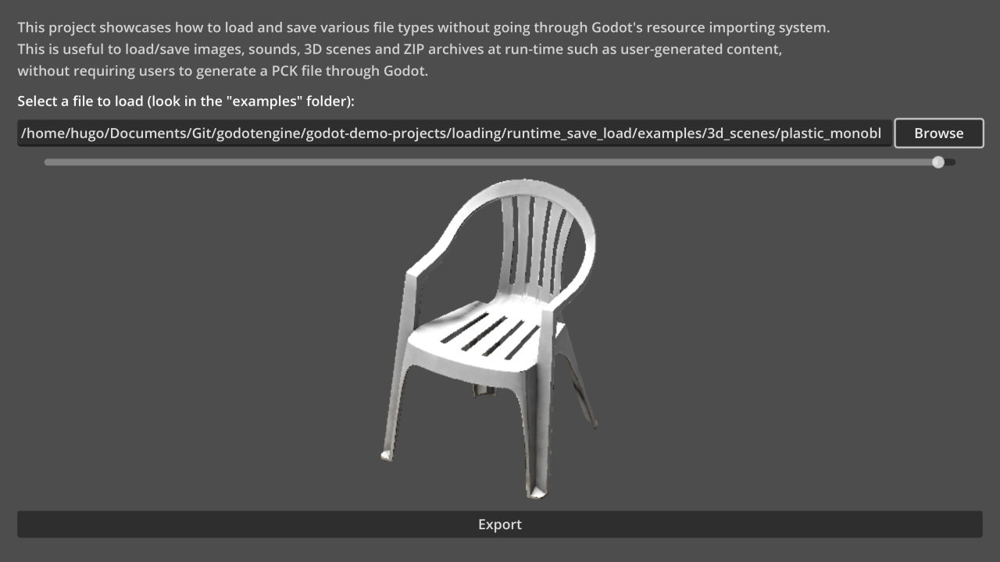
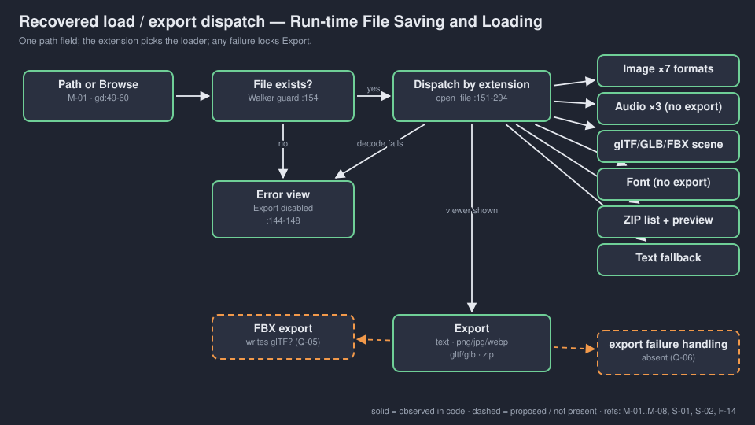
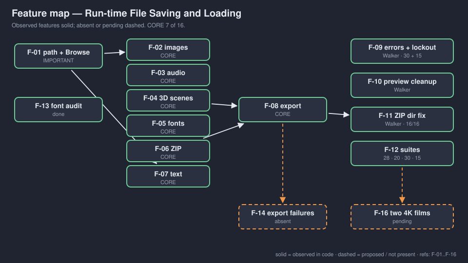

# walker-loading-runtime-save-load — Game Design Document (recovered)

| | |
|---|---|
| Version | 0.1.0-recovered |
| Date | 2026-09-27 |
| Author | Zelda (agent, silent) for Nik Bear Brown |
| Command | `/gdd reverse --path godot silent` |
| Mode | recovered |
| Revision | 1 |
| Gates | gate — unsigned at time of writing (vision ○ · systems ○ · world ○ · scope ○) |
| Source | independent copy of Godot demo `loading/runtime_save_load`, upstream commit `a3b5c11` `[OBSERVED README.md:3-4]` |
| Verdict | **Tech demo, not a game.** A file viewer: type or browse to a file, the matching viewer shows it, Export writes it back out. |

Provenance tags: `[OBSERVED path:line]` the code does this · `[INFERRED]` implied, evidence stated · `[MISSING]` the code cannot say; each is an open question in `decisions.md`. Code paths are relative to `godot/`. A recovered GDD describes what exists; it approves nothing. Image and diagram links are relative to `design/`; the root `GDD.md` is an identical copy, so open `design/GDD.md` or `design/DECK.html` to see the pictures.

*Upstream screenshot referenced by `godot/README.md:45`, retained from the source demo `[INFERRED: listed in the upstream README]`. Not a Walker capture; image pixels, audio playback and 3D rendering were not visually verified `[OBSERVED FRICTIONAL.md]`.*

## 1. Vision summary

**What exists.** One `Control` scene: a path field with Browse, six result viewers (plain text, texture, audio button, 3D `SubViewport` with zoom, font specimen, ZIP list + preview), an error label and an Export button `[OBSERVED runtime_save_load.tscn:5-193]`. `open_file()` dispatches on the file extension to the right runtime loader, bypassing Godot's import system `[OBSERVED runtime_save_load.gd:151-294]`.

**What it teaches.** Loading and saving user files at run time without a PCK: `Image.load_from_file` and `save_png/jpg/webp`; `AudioStream*.load_from_file`; `GLTFDocument`/`FBXDocument` → `generate_scene`, and `GLTFDocument.write_to_filesystem`; `FontFile.load_dynamic_font/load_bitmap_font`; `ZIPReader`/`ZIPPacker`; `FileAccess` for text `[OBSERVED runtime_save_load.gd; godot/README.md:3-9]`. Upstream's stated use: user-generated content `[OBSERVED godot/README.md:6-8]`.

**Walker's changes.** Local title; imported scenes parented to the preview `SubViewport` and marked for cleanup; ZIP export writes directory entries once with `add_directory`; missing-file and corrupt-file guards that show an error and disable Export `[OBSERVED README.md:4-6; runtime_save_load.gd:35-38,129-138,144-156,175-177,193-195,217-218,254,271-273; FRICTIONAL.md]`.

**Why it is in Walker / for whom.** `[MISSING → Q-01, Q-02]`. A plausible Walker reading is runtime user content (mods, levels, avatars) for Walker games `[INFERRED from upstream's stated purpose]`; nothing in the folder says Walker wants that.

**Player fantasy.** None. No player, goal or fail state `[OBSERVED: no [input] section, no game script]`.

**Biggest unresolved question.** Seven file categories are all "core" to what this demo teaches, which puts CORE over the 40% line (§11, Q-03). For a tech demo that is a scope question, not a production crisis, but it needs a human answer.

## 2. Design pillars

None stated `[MISSING → Q-01]`. Readings `[INFERRED]`:

| ID | Inferred pillar | Evidence |
|---|---|---|
| P-01 | One path field, every format | single `open_file` dispatcher `runtime_save_load.gd:151-294` |
| P-02 | Never export what you could not load (Walker) | `show_error` disables Export `:144-148`; guards before every viewer |
| P-03 | The preview never leaks | imported roots tagged `runtime_import` and freed on switch `:35-38,217` |

## 3. Core loop

Enter path or Browse → exists? → dispatch by extension → decode → show viewer, set export filters → (optionally) Export to a new path. Any failure → error view, Export disabled; the next valid load resets it `[OBSERVED runtime_save_load.gd:29-47,49-60,144-294]`. No session or meta loop `[OBSERVED absence]`.

## 4. Player Experience Goals

`[MISSING → Q-02]` Candidate learner outcomes `[INFERRED]`:

| ID | Candidate outcome | Evidence |
|---|---|---|
| PX-01 | Pick the right runtime loader for a file type | dispatcher branches |
| PX-02 | Know which formats can be exported at run time and which cannot | comments `:103-105, 118-120` |
| PX-03 | Guard user files before decoding them | Walker guards |

## 5. Mechanics

### M-01 Path entry and Browse `[OBSERVED runtime_save_load.gd:49-60; runtime_save_load.tscn:46-61,195-197]`
`LineEdit.text_submitted` or `FileDialog.file_selected` → `open_file(path)`. FileDialog `access = 2` (filesystem) `[:61]`.

### M-02 Images `[OBSERVED :159-181]`
JPG/JPEG/PNG/WebP/SVG/TGA/BMP via `Image.load_from_file`; null or empty → error. Export filters PNG/JPEG/WebP.

### M-03 Audio `[OBSERVED :183-201]`
Ogg Vorbis, MP3, WAV via `load_from_file`; null stream → error. Shows duration mm:ss; pressing the audio button plays `[:63-64]`. Export disabled (no runtime encoder for Ogg/MP3) `[:102-105,197]`.

### M-04 3D scenes `[OBSERVED :203-235]`
glTF/GLB through `GLTFDocument`, FBX through `FBXDocument`; generated root tagged `runtime_import` and added to the preview `SubViewport`. Zoom slider −100…−0.1 (default −1.2) drives orthographic camera size `[:67-70; tscn:140-146]`. Export writes glTF/GLB via `GLTFDocument.write_to_filesystem` `[:107-115]`.

### M-05 Fonts `[OBSERVED :237-260]`
TTF/OTF/WOFF/WOFF2/PFB/PFM dynamic, FNT/FONT bitmap; rejected unless data is non-empty and face count > 0 (Walker guard). Specimen at 48 px `[tscn:148-158]`. Export disabled.

### M-06 ZIP `[OBSERVED :262-283, 73-76, 122-140]`
`ZIPReader.open`; sorted entry list with folders disabled; selecting an entry previews it as UTF-8. Export re-packs: directories first via `add_directory`, then files (Walker fix; before it, each directory was written twice: 12 entries from 8) `[FRICTIONAL.md 12:03]`.

### M-07 Plain-text fallback `[OBSERVED :285-294]`
Any other extension is read as text; empty or binary → error. Export writes the text back `[:85-88]`.

### M-08 Error view `[OBSERVED :144-148]`
Hides all viewers, shows "ERROR: …" in red 24 px, disables Export.

Tuning values (recorded, not approved): JPG export quality 0.9 `[:95]`; SubViewport 1050×400, MSAA 3D ×2 (`msaa_3d = 2`), `scaling_3d_scale` 2.0 `[tscn:105-110]`; orthographic camera size 1.2 `[tscn:112-117]`; directional shadow 8192, soft filter 5 `[project.godot:40-41]`.

## 6. Systems

### S-01 Viewer state `[OBSERVED :29-47]`
`reset_visibility()` hides every viewer, frees imported 3D roots, clears the ZIP list, hides the error, re-enables Export. Each branch calls it only after its decode succeeds (Walker ordering).

### S-02 Export routing `[OBSERVED :84-140]`
Export writes whatever viewer is visible; the extension of the chosen path picks the encoder.

### S-03 Example corpus `[OBSERVED godot/examples/]`
3 fonts, 6 images, 3 audio files, 1 glTF chair (+3 textures), 1 ZIP, 1 text file; `.gdignore` keeps them out of Godot's importer.

## 7. Progression

None `[OBSERVED absence]`.

## 8. World

None `[OBSERVED absence]`. The 3D preview has three lights and a camera, not a world `[tscn:112-139]`.

## 9. Narrative

None `[OBSERVED absence]`.

## 10. Characters

None `[OBSERVED absence]`.

## 11. Features and priority

Tags are Zelda's reading of what the demo teaches `[INFERRED]`, provisional.

| ID | Feature | Tag | Paths | Status |
|---|---|---|---|---|
| F-01 | Path entry + Browse | IMPORTANT | `:49-60` | done; click+Enter tested |
| F-02 | Image load | CORE | `:159-181` | done; 6 formats loaded, PNG/WebP pixel bytes round-trip |
| F-03 | Audio load + play | CORE | `:183-201` | load/decode tested; playback not listened to |
| F-04 | 3D scene load + zoom | CORE | `:203-235` | glTF/GLB tested; FBX untested |
| F-05 | Font load + specimen | CORE | `:237-260` | 3 fonts load; rendering unverified |
| F-06 | ZIP browse + preview | CORE | `:262-283` | entries listed |
| F-07 | Plain-text fallback | CORE | `:285-294` | text bytes round-trip |
| F-08 | Export (text, images, glTF/GLB, ZIP) | CORE | `:84-140` | direct-handler round trips pass (not UI capture) |
| F-09 | Error view + Export lockout (Walker) | IMPORTANT | `:144-156` + guards | 30 missing-file + 15 corrupt-file checks |
| F-10 | Preview parenting + cleanup (Walker) | IMPORTANT | `:35-38, 217-218, 230-231` | one imported root remains; freed on switch |
| F-11 | ZIP directory export fix (Walker) | IMPORTANT | `:129-138` | 16/16 |
| F-12 | Headless suites | IMPORTANT | `godot/test_*.gd` | pass `[OBSERVED logs]` |
| F-13 | Font attribution audit | IMPORTANT (release) | `FONT-AUDIT.md`, `audit_font_metadata.py` | done for Newsreader and Hack |
| F-14 | Export failure handling (permissions, bad destination) | NICE | — | absent / untested (Q-06) |
| F-15 | Custom binary formats, generated SVG | NICE | upstream footnotes `godot/README.md:24-29` | out of scope upstream |
| F-16 | Two native-4K Liam films | IMPORTANT (Walker process) | `README.md` | pending |

**CORE percentage: 7 of 16 = 44%.** Over the 40% line. Re-prioritization attempted: F-07 plain text is the fallback, not a category, and could drop to IMPORTANT (6/16 = 38%); F-05 fonts cannot be exported and could be read as a viewer-only side branch (5/16 = 31%). Either keeps the demo whole because the code already exists; nothing is cut. Silent mode: tags left as they are. **Two options for Nik Bear Brown**, logged as Q-03: (1) accept a reduced CORE by retagging F-07 (and optionally F-05) as IMPORTANT, i.e. the film teaches five categories and mentions the rest; or (2) keep all seven as CORE and give the films the time to cover them.

## 12. Out of scope

| Item | Reason | Decided |
|---|---|---|
| Custom binary formats, procedural SVG export | "not shown in this demo" `[OBSERVED godot/README.md:24-29]` | upstream |
| Audio and font export | no standard runtime encoder `[OBSERVED :102-105,117-120]` | upstream |
| Changing upstream assets | "preserved assets" `[OBSERVED FRICTIONAL.md]` | Walker copy |
| Loading PCK/ZIP as data packs | pointed to `ProjectSettings.load_resource_pack` in a comment only `[:267-269]` | upstream |

## 13. Technical

Godot 4.7 feature tag `[OBSERVED project.godot:22]`, verified with Godot 4.7.2 headless `[OBSERVED FRICTIONAL.md]`. Renderer GL Compatibility `[:38-39]`, `low_processor_mode=true` `[:23]`, stretch `canvas_items`/`expand`, vsync off `[:32-34]`. Main scene `res://runtime_save_load.tscn` `[:21]`. No `[input]`, no autoloads, no named layers. No exported vars or custom signals; eight scene signal connections `[tscn:195-202]`. FBX has known runtime-loading issues upstream (issue #96043) `[OBSERVED godot/README.md:31-32]`. `[INFERRED]` A loaded FBX sets the export filter to `*.fbx` `[:232]` but export always uses `GLTFDocument` `[:107-115]`, so an FBX "export" would write glTF data under an `.fbx` name; untested.

Licences `[OBSERVED README.md; godot/README.md:47-54; FONT-AUDIT.md]`: code MIT (Godot Engine contributors); chair CC0 (Poly Haven); audio CC BY-SA 4.0 (Red Eclipse); Inter OFL notice retained; Newsreader OFL and Hack MIT/Bitstream exact-binary attribution recorded in FONT-AUDIT.md.

## 14. Risks

| ID | Risk | Cat | L/I | Mitigation |
|---|---|---|---|---|
| R-01 | Adopted for real user content while export failures and parser fuzzing are untested | Security/tech | M/H | Q-06; the corrupt-file guards are "NOT … exhaustive parser fuzz" `[FRICTIONAL.md 13:03]` |
| R-02 | FBX export writes glTF under `.fbx` | Technical | M/L | Q-05; test or remove the filter |
| R-03 | CC BY-SA audio obligations missed in film descriptions | Legal | M/M | Q-07 |
| R-04 | Direct-handler export diagnostics read as UI verification | Process | M/M | keep the logs' wording "not captured UI interaction" |
| R-05 | Seven CORE categories stretch a single film | Scope | M/M | Q-03 |

**Top 3.** R-01, R-03, R-04.

## 15. Open questions

In `decisions.md`: Q-01 purpose in Walker; Q-02 learner outcomes; Q-03 CORE overage (options above); Q-04 teach the Walker fixes or keep them quiet; Q-05 FBX: test, fix, or drop; Q-06 export failure handling required?; Q-07 CC BY-SA attribution in films; Q-08 definition of done and who signs.

## 16. Tests

Existing `[OBSERVED godot/test_*.gd; logs]`:
- `test_load.gd` → load-edit-focus-fixed / load-regression-1303: 28 checks, click + Enter submission, text, six image formats, three fonts, three audio decodes, ZIP listing. "HEADLESS LOAD ONLY".
- `test_roundtrip.gd` → roundtrip-zip-fixed (16) and roundtrip-glb (20): text bytes, PNG/WebP RGBA bytes, JPG dimensions, ZIP entries identical, glTF/GLB regenerate with the same mesh count, one imported root, freed on switch. Output in unique `roundtrip-*/` directories.
- `test_errors.gd` → errors-missing-fixed: 30 checks across six missing extensions, error view, disabled Export, recovery.
- `test_corrupt.gd` → corrupt-guarded: 15 checks on `corrupt-NdyxEF/` fixtures (text renamed to PNG/Ogg/ZIP/TTF/glTF).

Proposed:

| ID | Setup | Action | Expected | Links |
|---|---|---|---|---|
| T-100 | read-only destination | Export PNG | error shown, no crash | F-14 |
| T-101 | FBX file | load, Export | either valid FBX or no `.fbx` filter | R-02 |
| T-102 | visible window | load each example | pixels, font, 3D chair visible | F-16 |
| H-01 | a learner | load each example | names which ones cannot be exported and why | PX-02 |

## Zelda's read — 7 failure modes

| Mode | Rating | Evidence |
|---|---|---|
| Ghost Center | PRESENT (expected) | §1 purpose `[MISSING]` |
| Mechanic Mirage | PRESENT (expected) | §4 outcomes restate the API |
| Implementation Void | PARTIAL | failure paths for load are tested; export failures and FBX are not |
| Priority Inflation | PRESENT | CORE 44% (Q-03) |
| Novelist's Trap | ABSENT | no lore |
| Completeness Fallacy | PARTIAL | README status says "Failure handling … pending" while FRICTIONAL records bounded guards; the gap between them is not written down anywhere else |
| Stagnant Artifact | ABSENT | dated FRICTIONAL.md; CHANGELOG.md starts here |

Three PRESENT: above Zelda's line of two. For a tech demo the third (Priority Inflation) is a film-scope question, not a production blocker.

## Zelda's notes (silent mode; what I would have said out loud)

1. **Walker has changed this demo more than any other in the batch** (five guard sites, viewport parenting, ZIP rewrite). That is good engineering and it means "independent copy" now understates the diff. Q-04: say so in the film, or at least in one README line.
2. **Do not let "loads user files" become "safe for user files."** The guards stop nonexistent and obviously corrupt inputs. They are not a sandbox.
3. **Q-03 is a film question.** Seven categories in one film is a list, not a lesson. Pick the five that export and let the other two be a closing card.
